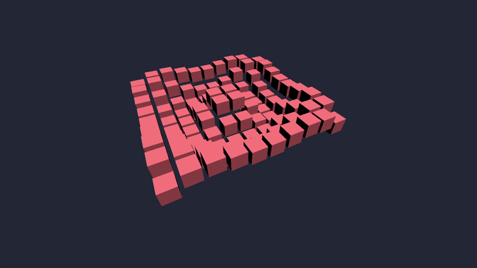

# Nyra 🦀

Nyra is a small, experimental 3D game engine I'm building in Rust.

I started it because I wanted to understand how game engines work under the hood, not just learn how to use one. It began with a triangle, then a cube, and somehow turned into a renderer, a world system, and a math library of my own.

It's still early, and the API changes whenever I find a better way to do something.



*100 animated cubes sharing one mesh and one material. No instancing yet.*

## Getting started

Clone the repository and run your first cube:

```bash
git clone https://github.com/KezzGR/nyra.git
cd nyra
cargo run -p nyra --example hello_cube
```

To explore the other examples, replace `hello_cube` with any name below.

## Examples

| Example | What it shows |
| --- | --- |
| [`hello_window`](crates/nyra/examples/hello_window.rs) | Open an empty window with `App::new().run()` |
| [`title`](crates/nyra/examples/title.rs) | Set a custom window title |
| [`hello_cube`](crates/nyra/examples/hello_cube.rs) | Create a mesh, material, and your first 3D entity |
| [`multiple_objects`](crates/nyra/examples/multiple_objects.rs) | Share the same mesh and material between multiple entities |
| [`transforms`](crates/nyra/examples/transforms.rs) | Position, rotate, and scale entities |
| [`materials`](crates/nyra/examples/materials.rs) | Give entities different colors using materials |
| [`textures`](crates/nyra/examples/textures.rs) | Load a PNG and reuse it with different material colors |
| [`uv`](crates/nyra/examples/uv.rs) | Tile textures and animate UV offsets |
| [`light`](crates/nyra/examples/light.rs) | Configure ambient lighting and animate the sun's direction |
| [`keyboard_input`](crates/nyra/examples/keyboard_input.rs) | Respond to key presses and releases, and exit the application |
| [`free_camera`](crates/nyra/examples/free_camera.rs) | Move around a scene with the free-fly camera |
| [`animation`](crates/nyra/examples/animation.rs) | Update an entity every frame using application state and delta time |
| [`spawning`](crates/nyra/examples/spawning.rs) | Spawn entities with Space and remove them with Backspace |
| [`cube_wave`](crates/nyra/examples/cube_wave.rs) | Animate 100 cubes sharing a mesh and material |

Run any example from the repository root:

```bash
cargo run -p nyra --example cube_wave
```

In examples with the free-fly camera, use **WASD** to move and the **mouse** to look around. Press **Escape** to release the cursor; click the window to capture it again.

## A small example

This creates a cube and rotates it every frame. `setup_with_state()` returns user-defined state, and `run_each_frame_with_state()` receives it on each frame:

```rust
use nyra::{App, Entity, EntityID, Material, Mesh, RunError, Transform};
use nyra_math::Quat;

struct AnimationState {
    cube: EntityID,
    angle: f32,
}

fn main() -> Result<(), RunError> {
    App::new()
        .setup_with_state(|ctx| {
            let mesh = ctx.assets.add_mesh(Mesh::cube());
            let material = ctx.assets.add_material(Material::default());

            let cube = ctx.world.spawn(
                Entity::new(Transform::default(), mesh).with_material(material)
            );

            AnimationState { cube, angle: 0.0 }
        })
        .run_each_frame_with_state(|ctx, state| {
            state.angle += ctx.delta_time;

            ctx.world[state.cube].transform.rotation =
                Quat::from_rotation_y(state.angle - 0.6);
        })
}
```

You don't have to use application state. For simpler programs, use `setup()` to initialize a scene and `run()` to display it, or `run_each_frame()` to execute a callback every frame without a separate state.

An `Entity` without a material is currently skipped by the mesh render pipeline. Assign a material explicitly, including when using `Material::default()`.

## What works

- **Rendering:** 3D meshes through `wgpu`, perspective projection, depth testing, and configurable directional and ambient lighting.
- **Geometry:** built-in cubes and cuboids, custom meshes with vertex and index data, and runtime mesh uploads.
- **Assets:** separate storage for meshes, materials, and textures, referenced by `MeshID`, `MaterialID`, and `TextureID`.
- **Materials and textures:** RGBA base colors, PNG loading, textured materials, texture reuse, runtime material color changes, and UV scaling and offsets. Transparency is not implemented yet.
- **Environment:** configurable sun direction and intensity, along with ambient lighting. Lighting parameters can be updated at runtime.
- **World:** spawn, access, transform, hide, and despawn entities using `EntityID`.
- **Application and input:** `winit` event loop, keyboard and mouse input, delta time, cursor control, custom window titles, application exit, and a free-fly camera.
- **Math:** a separate `nyra_math` crate with vectors, quaternions, matrices, transforms, and camera calculations instead of `glam`.

## Project structure

The workspace contains two crates:

- **[`nyra`](crates/nyra)**: rendering, application lifecycle, world, assets, camera, input, and GPU resource management.
- **[`nyra_math`](crates/nyra_math)**: my own implementations of `Vec2`, `Vec3`, `Quat`, `Mat4`, and view/projection math, with tests.

The engine keeps entities in `World` and shared resources in `Assets`. Each entity references its mesh and optional material through IDs, allowing multiple entities to share the same resources.

The renderer manages their GPU-side representations and synchronizes them during rendering.

## What's missing

There is no 3D model importer, PBR, shadows, physics, skeletal animation, or editor yet.

Lighting currently supports one directional light and ambient illumination. Rendering uses a single basic mesh pipeline, without transparency or instanced rendering.

New meshes and textures can be uploaded at runtime, but modifying an already uploaded mesh or texture does not automatically update its GPU copy. Material properties and lighting parameters, however, are synchronized every frame.

Performance has not been systematically benchmarked.

## Built with

Rust · [`wgpu`](https://github.com/gfx-rs/wgpu) · [`winit`](https://github.com/rust-windowing/winit) · [`image`](https://github.com/image-rs/image) · `bytemuck` · `pollster` · `nyra_math`

## License

MIT.