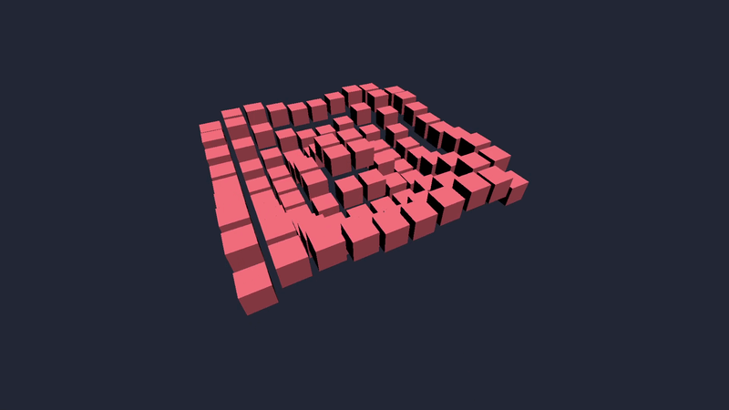

# Nyra 🦀

I'm building my own 3D game engine in Rust.

Why? Mostly because I wanted to understand how game engines actually work instead of just using one.

It started with a triangle. Then a cube. Then a camera, an input system, a basic world, and a bunch of other things I didn't know how to write a few weeks ago.

The cube has friends now. And they move.



*100 cubes sharing one mesh, moving in a sine wave.*

## Getting Started

Clone the repository:

```bash
git clone https://github.com/KezzGR/nyra.git
cd nyra
```

Run the cube wave example:

```bash
cargo run -p nyra --example cube_wave
```

There are a few other examples too:

```bash
cargo run -p nyra --example world
cargo run -p nyra --example camera_move
cargo run -p nyra --example delete_objects
```

In examples using the free-fly camera, use **WASD** to move and the **mouse** to look around. Press **Escape** to release the cursor and click to capture it again.

In `delete_objects`, **Space** removes cubes and **Enter** cycles through hiding them.

## What Works So Far

Nyra can render basic 3D geometry using `wgpu`. There's perspective projection, depth buffering, simple directional lighting, and support for drawing multiple objects using the same mesh.

So far I've written procedural generators for cubes and cuboids. Nothing fancy yet, but I'm planning to add more shapes.

There's also a small world system. You can spawn objects, move or rotate them, hide them, and remove them entirely. Each object gets its own `ThingID`, so you don't have to rely on its position in a vector.

The camera supports free movement with the mouse and keyboard. Input handling includes key presses, releases, held keys, mouse movement, and cursor locking.

I've also been working on making the API less annoying to use. You don't need to deal with the window or event loop yourself just to put a cube on the screen.

## A Small Example

Here's a cube that moves upward:

```rust
use nyra::{App, Mesh, RunError, Thing, ThingID, Transform};

struct GameState {
    cube: ThingID,
}

fn main() -> Result<(), RunError> {
    App::<GameState>::new()
        .setup(|game| {
            let mesh = game.world.add_mesh(Mesh::cube());

            let cube = game.world.spawn(
                Thing::new(Transform::default(), mesh)
            );

            GameState { cube }
        })
        .run_with_state(|game, state| {
            game.world[state.cube].transform.position.y +=
                game.delta_time;
        })
}
```

`setup()` runs once and returns whatever state your game needs. `run_with_state()` receives that state every frame.

For simpler applications, you can skip the state entirely and just use `App::run()`.

Objects can also be accessed with `world.get()` and `world.get_mut()` if you don't want to panic when an ID no longer exists.

The [cube wave example](crates/nyra/examples/cube_wave.rs) shows a slightly more interesting use of the world API.

## Project Structure

There are currently two crates:

- **`nyra`** contains the renderer, application loop, world, camera, input, and the rest of the engine.
- **`nyra_math`** is where I'm experimenting with my own math implementations. Right now it mainly contains a custom `Vec3`.

I'm still using `glam` for some of the engine's math, particularly camera and transform calculations.

## What's Missing?

A lot, honestly.

There are no materials, textures, physics, model loading, or proper animation system yet. There's no editor either.

Meshes can be added while the game is running, and the renderer will upload them to the GPU. However, changing the vertices of an existing mesh won't update its GPU copy yet.

Rendering is also pretty basic. There's no instancing, and I haven't really started optimizing things.

The API is still changing quite often, usually whenever I try to build something with it and realize that my previous design was inconvenient.

For now, I'm mostly trying to get the fundamentals right and learn how all of this works.

## Built With

- Rust
- `wgpu`
- `winit`
- `glam`
- `bytemuck`
- `pollster`

## License

MIT
