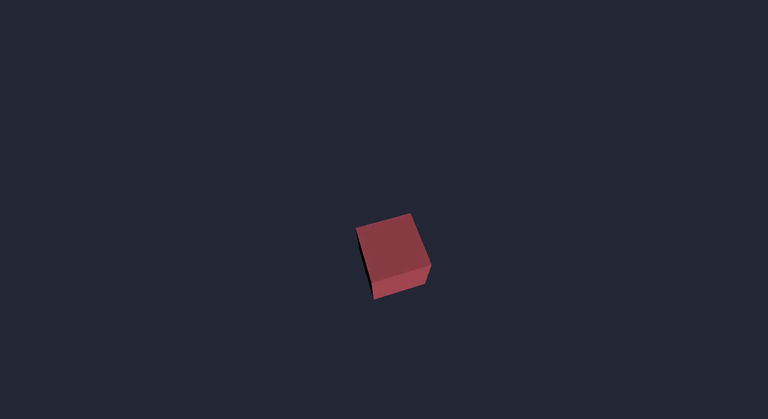

# Nyra 🦀

I'm building my own 3D game engine in Rust.

Why? Mostly because I wanted to understand how game engines actually work instead of just using one.

So I started writing my own renderer, input system, camera, and everything else, one piece at a time.

Right now, Nyra renders a spinning cube that you can freely fly around.

Yes, a cube. We're getting there.



## Getting Started

Clone the repository and run the camera example:

```bash
git clone https://github.com/KezzGR/nyra.git
cd nyra
cargo run -p nyra --example camera_move
```

**Controls:**

- **WASD**: Move around
- **Mouse**: Look around
- **Escape**: Release the cursor
- **Left click**: Capture it again

## What Works So Far

### Rendering

- 3D rendering with `wgpu`
- Procedural cube and cuboid generation
- Indexed meshes with face normals
- Perspective projection
- Basic Lambert lighting
- Depth buffering
- Window resizing

### Camera & Input

- Free-fly camera with keyboard and mouse controls
- Quaternion-based camera rotation
- World-space and local-space movement
- Keyboard input with pressed, held, and released states
- Mouse movement tracking
- Delta time for frame-independent movement
- Cursor locking and visibility controls

### Application

Nyra handles the window, event loop, and rendering internally.

There's also a small API for running your own code without having to deal with `winit` directly.

## The API

Here's the current free-fly camera example:

```rust
use nyra::{App, FreeFlyController, RunError};

fn main() -> Result<(), RunError> {
    let mut controller = FreeFlyController::default();

    App::new()
        .setup(|game| {
            game.cursor.set_locked(true);
            game.cursor.set_visible(false);
        })
        .run(move |game| {
            controller.update(game);
        })
}
```

`setup()` runs once, after the window and renderer are initialized.

`run()` takes a callback that gets executed every frame.

Both use `GameContext`, which gives access to the camera, keyboard, mouse, cursor, and delta time.

I want the API to stay simple. If I want to hide the cursor, I should be able to write:

```rust
game.cursor.set_visible(false);
```

And that's it.

## Project Structure

Nyra currently consists of two Rust crates:

- **`nyra`**: Rendering, application lifecycle, camera, input, and other engine systems.
- **`nyra_math`**: My own little math experiments, currently including a custom `Vec3` implementation.

The engine also uses `glam` for camera and transform math.

## Current State

This is still a very early project.

There's no proper scene system yet. No asset loading, no materials, and no API for spawning arbitrary objects.

The renderer currently draws one built-in rotating cube.

I'm learning Rust and graphics programming while building this, so expect the code and API to change quite a bit.

For now, I'm just building things, breaking things, figuring out why they broke, and moving on to the next piece.

## Built With

- Rust
- `wgpu`
- `winit`
- `glam`
- `bytemuck`
- `pollster`

## License

MIT